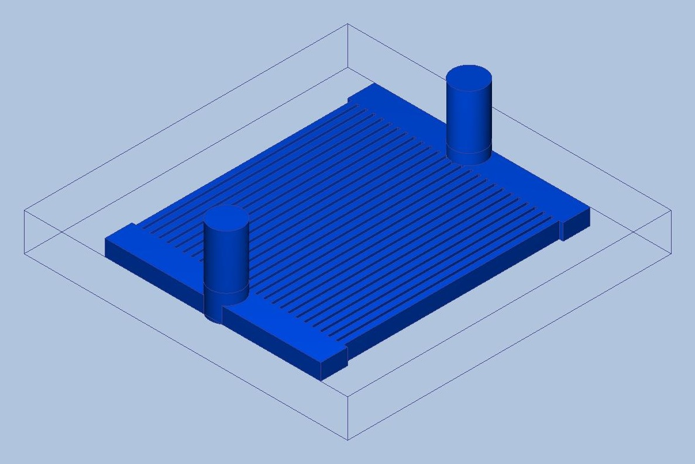
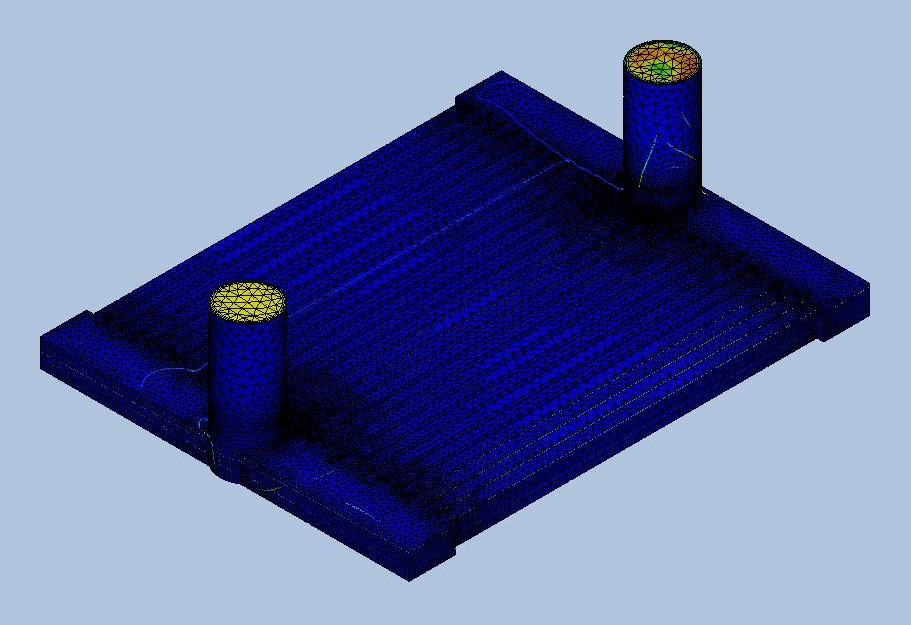
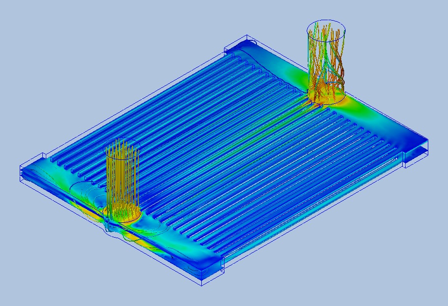
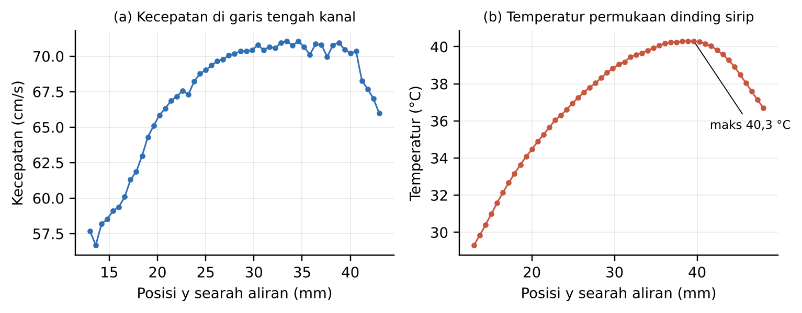

# Dokumentasi CFD CP-01

Simulasi CP-01 dengan material sesuai rancangan, dijalankan 1 November 2026. Ringkasan asli Autodesk CFD tersimpan di [`data/cfd_raw/CP-01_run2.sum`](../data/cfd_raw/CP-01_run2.sum), sedangkan data profil sepanjang kanal ada di [`CP-01_run2_kecepatan_garis_kanal.csv`](../data/cfd_raw/CP-01_run2_kecepatan_garis_kanal.csv) dan [`CP-01_run2_temperatur_dinding_sirip.csv`](../data/cfd_raw/CP-01_run2_temperatur_dinding_sirip.csv) (satuan cm, cm/s, dyne/cm², °C).

## Pengaturan

| Item | Pengaturan |
| --- | --- |
| Perangkat lunak | Autodesk CFD 2027 (versi 27.0.69), skema adveksi ADV 5 |
| Analisis | Tunak, laminar, inkompresibel, perpindahan panas terkonjugasi; gravitasi dan radiasi tidak aktif |
| Geometri | Pelat 60 × 60 × 7 mm, area kanal 40 × 40 mm, 26 kanal (w 1,0 mm, t 0,5 mm, H 3,0 mm), port Ø6 mm susunan Z, die 30 × 30 mm |
| Part1.Body1 (fluida) | Water pustaka Autodesk CFD: μ 1,003 mPa·s, c_p 4.182 J/kg·K, k 0,6 W/m·K, densitas bergantung temperatur |
| Part1.Body2 (*cold plate*, termasuk *base*, sirip, dan tutup) | Material kustom Al 6061-T6: k 1,67 W/cm·K (167 W/m·K), ρ 2,7 g/cm³, c_p 0,896 J/g·K |
| Part1.Body3 (die) | Silicon pustaka Autodesk CFD (k bergantung temperatur) |
| Inlet | Kecepatan normal 0,59 m/s; laju aliran terhitung *solver* 16,04 cm³/s (0,963 L/menit); temperatur 25 °C |
| Outlet | Tekanan 0 Pa (*gauge*) |
| Sumber panas | *Total heat flux* 300 W pada permukaan bawah die |
| Mesh | Otomatis, *resolution factor* 1,0, *mesh enhancement* 3 lapisan; 1.112.457 elemen, 292.777 node |
| *Solver* | *Intelligent solution control* aktif; berhenti konvergen pada iterasi 367; waktu sekitar 4,8 jam (4 proses) |

## Hasil

| Besaran | Nilai | Sumber di .sum |
| --- | --- | --- |
| Temperatur maksimum (die) | 51,38 °C | *Field variable results*, Temp Max |
| *Pressure drop* inlet–outlet | 677,2 Pa | *Inlet bulk pressure* 6.771,64 dyne/cm² (outlet 0) |
| Laju massa inlet / outlet | 16,015 / 16,052 g/s | *Openings* |
| Panas dinding ke fluida | 299,93 W | *Fluid energy balance* |
| Galat energi numerik | −0,37 W (0,12%) | *Energy Out − Energy In* |
| Temperatur keluar rata-rata massa | 29,48 °C | 25 + 299,93 / (16,015 × 4,182) |
| Bilangan Reynolds di port | sekitar 3.020 | *Openings* |

## Perbandingan dengan model fisika

Dihitung dengan `python hitung_fisika.py --w 1.0 --t 0.5 --H 3.0 --flow 0.9626 --material al6061 --air autodesk`.

| Besaran | CFD | Model fisika | Selisih |
| --- | --- | --- | --- |
| T maks | 51,4 °C | 53,9 °C | −2,5 °C |
| ΔP total | 677 Pa | 571 Pa | +19% |
| T keluar | 29,48 °C | 29,48 °C | 0 |

## Profil sepanjang kanal

Dua garis searah aliran (sumbu y) pada kanal dekat tengah pelat, z = 3,5 mm (tengah tinggi kanal):

| Garis | Posisi | Hasil |
| --- | --- | --- |
| Garis tengah kanal | x = 29,25 mm, y = 13–43 mm | Kecepatan naik dari 57 cm/s ke sekitar 70 cm/s pada 15 mm pertama, lalu relatif datar dan turun di dekat manifold keluar |
| Permukaan dinding sirip | x = 28,75 mm, y = 13–48 mm | Temperatur naik dari 29,3 °C ke maksimum 40,3 °C pada y ≈ 40 mm, lalu turun ke arah keluar |

Bila aliran terbagi merata, kecepatan rata-rata kanal adalah 16,04 cm³/s / (26 × 0,1 cm × 0,3 cm) = 20,6 cm/s, sehingga kecepatan garis tengah sekitar 40 cm/s (kira-kira 1,9 kali rata-rata untuk kanal dengan rasio sisi 1:3). Kecepatan sekitar 70 cm/s menunjukkan kanal ini menerima aliran berlebih, sesuai pola garis alir.

## Catatan

1. *Outlet bulk temperature* di ringkasan Autodesk CFD (30,29 °C) adalah rata-rata luas, sehingga tidak dipakai. Temperatur keluar rata-rata massa dihitung dari neraca energi.
2. Bidang *Bulk Calculator* yang diekspor pada run ini (luas 14,4 cm²) memotong pelat, bukan pipa outlet, sehingga hasilnya tidak dipakai.
3. Inlet diatur sebagai kecepatan, sehingga debit 3,8% di bawah target 16,67 cm³/s. Kasus berikutnya memakai *volume flow rate*.
4. Reynolds di port sekitar 3.000 (transisi), sedangkan di kanal sekitar 300 (laminar). Pengaruh model laminar di port akan diuji dengan satu simulasi turbulen.
5. Mesh ini menjadi mesh halus untuk uji GCI; mesh sedang dan kasar memakai *resolution factor* sekitar 1,3 dan 1,7 dengan pengaturan lain yang sama.

## Gambar

Model CFD CP-01 secara utuh: *cold plate* Al 6061-T6 dengan pipa port inlet dan outlet (susunan Z). Die silikon terpasang di sisi bawah pelat.

Mesh 1.112.457 elemen.

Garis alir: aliran terkonsentrasi pada kanal di jalur diagonal antara port inlet dan outlet.

Profil kecepatan di garis tengah kanal dan temperatur permukaan dinding sirip.
